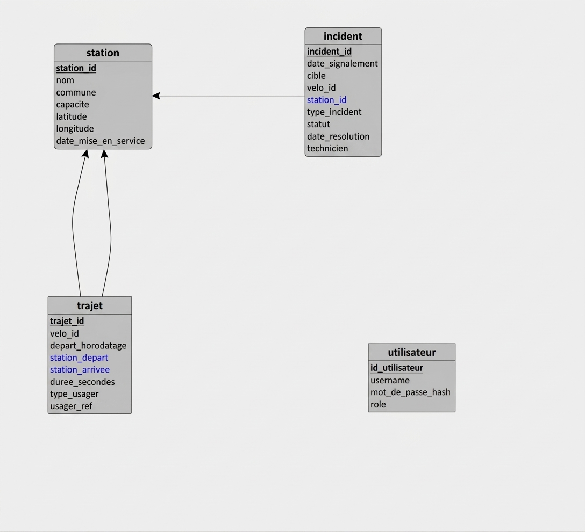

# Schéma de données

## Modèle logique de données

Le modèle relationnel est celui des cours SQL/Merise : chaque entité devient
une table, chaque identifiant une clé primaire et chaque référence une clé
étrangère. Les suppressions/recréations du script SQL suivent l'ordre inverse
des dépendances; l'import suit l'ordre direct.

Une station peut être la station de départ ou d'arrivée de plusieurs trajets.
Un incident concerne soit un vélo, soit une station; seule la référence
correspondant à `cible` est renseignée. Il n'existe pas de table vélo dans le
périmètre V1, donc `velo_id` n'est pas une clé étrangère.

## Tables et contraintes SQL

Les définitions ci-dessous décrivent l'état actuel de `sql/schema.sql`.

| Table | Clés et contraintes |
|---|---|
| `station` | `station_id VARCHAR(10)` clé primaire; `nom`, `commune`, `capacite`, coordonnées et date obligatoires; `capacite CHECK (capacite > 0)`. |
| `trajet` | `trajet_id VARCHAR(12)` clé primaire; départ obligatoire et clé étrangère vers `station`; arrivée nullable et clé étrangère vers `station`; `duree_secondes CHECK > 0`; `type_usager` limité à `abonne` ou `occasionnel`. |
| `incident` | `incident_id VARCHAR(12)` clé primaire; station nullable avec clé étrangère; `cible` limité à `velo` ou `station`; `statut` limité à `ouvert`, `en_cours`, `resolu`; contrainte vérifiant que `cible` et sa référence correspondent; date de résolution présente si et seulement si statut `resolu`, et postérieure ou égale au signalement. |
| `utilisateur` | `id_utilisateur SERIAL` clé primaire; `username` unique et obligatoire; empreinte du mot de passe obligatoire; rôle limité à `exploitant` ou `direction`. |

Des index accélèrent les filtres et tris sur les trajets, incidents et communes.
Les identifiants de compte sont gérés par `sql/comptes.sql`, avec un hash bcrypt.

## Règles de gestion RG1 à RG8

| Règle | Application actuelle |
|---|---|
| RG1 — station unique, capacité strictement positive | Clé primaire sur `station_id` et `CHECK (capacite > 0)` dans le schéma. La capacité est strictement positive et l'identifiant de station est unique. |
| RG2 — départ obligatoire, stations existantes | `station_depart NOT NULL` et clés étrangères sur les deux colonnes de station; l'import rejette les références inconnues. |
| RG3 — arrivée inconnue autorisée | `station_arrivee` est nullable; les agrégations ne comptent une arrivée que si la référence existe. |
| RG4 — durée strictement positive | `CHECK (duree_secondes > 0)` et rejet des durées invalides dans l'import. |
| RG5 — pseudonyme uniquement pour abonné | Le domaine de `type_usager` est vérifié, mais le schéma et l'import ne garantissent pas encore la cohérence entre `type_usager` et `usager_ref`. L'API masque la valeur de `usager_ref` à la direction; aucun identifiant direct ni table d'abonnés n'est importé. |
| RG6 — incident visant une seule cible | `CHECK` sur `cible` et les références; `station_id` est une clé étrangère. L'import rejette les couples cible/référence incohérents. |
| RG7 — statuts et transitions | Le schéma limite les statuts; `api/routers/incidents.py` contrôle les transitions autorisées avant mise à jour. |
| RG8 — résolution cohérente et technicien attendu | `CHECK` lie le statut `resolu` à la présence de `date_resolution`, et vérifie la chronologie. L'import rejette les dates incohérentes et signale les techniciens absents sans rejeter l'incident. |

## Audit et import

Comptage des CSV sources et exécution du pipeline actuel d'import :

| Source | Lignes CSV | Importées | Rejets journalisés | Avertissements journalisés |
|---|---:|---:|---:|---:|
| `stations.csv` | 120 | 120 | 0 | 0 |
| `trajets.csv` | 2 030 | 1 998 | 32 | 0 |
| `incidents.csv` | 180 | 177 | 3 | 25 |
| **Total** | **2 330** | **2 295** | **35** | **25** |

Les 32 rejets de trajets sont : 12 secondes occurrences de `trajet_id`, 5
horodatages non analysables, 9 durées invalides et 6 références de station
inconnues. Les 3 rejets d'incidents ont une date de résolution antérieure au
signalement. Les 25 avertissements enregistrent l'absence de technicien.
L'avertissement est une information supplémentaire et ne s'ajoute pas aux
rejets pour le contrôle des volumes : les lignes CSV se répartissent en 2 295
importées et 35 rejetées.

Le pipeline normalise aussi 125 valeurs de statut et repère 5 horodatages au
format jour/mois/année; ces normalisations ne sont actuellement pas toutes
tracées comme avertissements, et les 5 dates ne sont pas analysées par le
parseur courant. Le journal produit contient 60 enregistrements : 35 rejets et
25 avertissements. Il est écrit dans `docs/journal_rejets.csv` (pas dans une
table `import_log`).

## Index et relations

`idx_trajet_depart_horodatage`, `idx_trajet_station_depart` et
`idx_trajet_station_arrivee` servent aux filtres trajets; `idx_incident_statut`
et `idx_incident_station_id` aux incidents; `idx_station_commune` au filtre
des stations. Les index n'ajoutent pas de règle métier; ils servent les
requêtes paginées et indicateurs.
